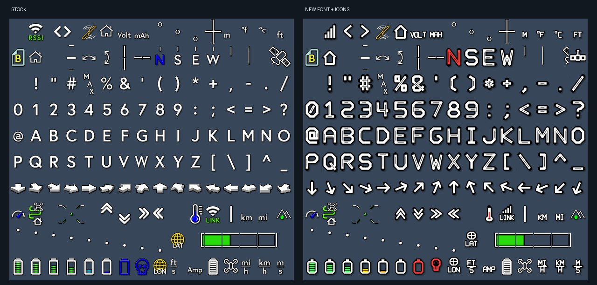
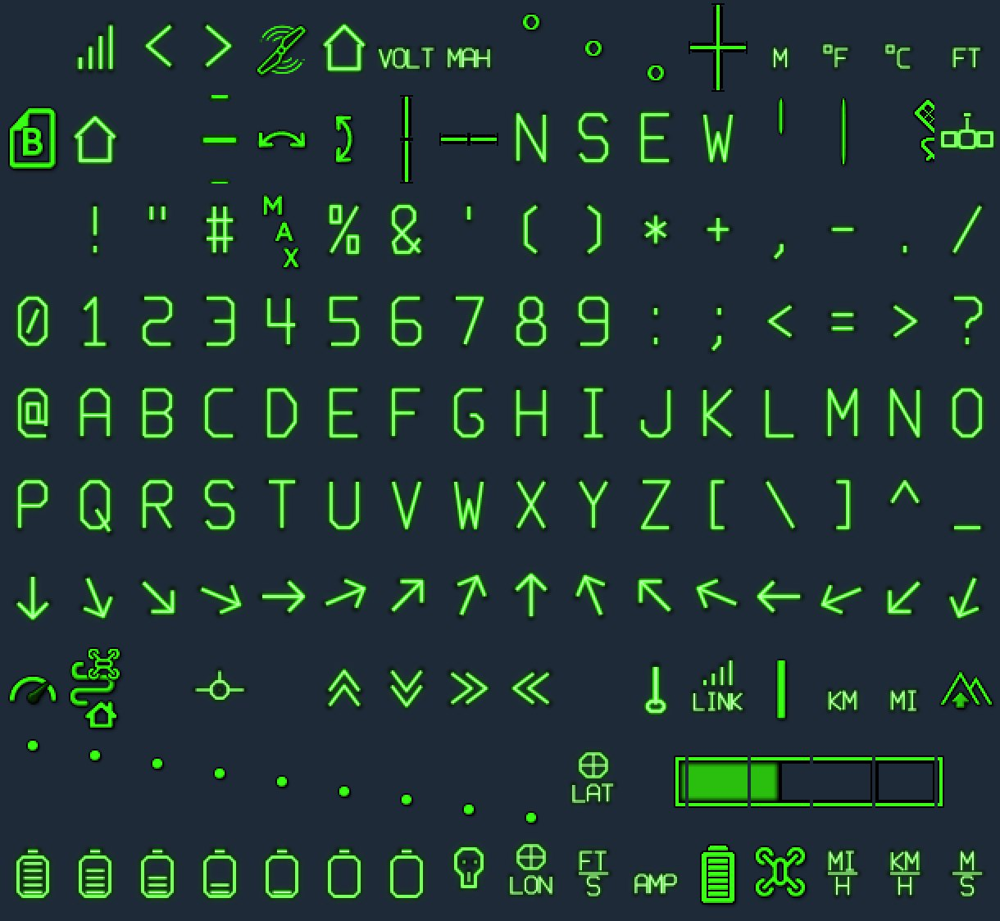

# PADDY Fonts for MSPOSD

Custom OSD fonts for the **Mabur FPV system**, designed for use with [`msposd`](https://github.com/OpenIPC/msposd).

Two styles, three font files:

| Font | File | Style | Size |
|------|------|-------|------|
| **PADDY Green** | `PADDY_green.mfont` | Neon-green, fighter-jet HUD inspired | Standard |
| **PADDY Octa S** | `PADDY_octa_S.mfont` | Octagonal glyph design | Small |
| **PADDY Octa L** | `PADDY_octa_L.mfont` | Octagonal glyph design | Large |

---

## Preview

### Stock vs. PADDY custom font + icons
Left: the stock msposd font. Right: the custom font with redesigned icons (RSSI bars, link, battery states, red N, etc.).



### Crosshair: stock vs. custom
Left: stock angled-corner crosshair. Right: custom rounded-bracket crosshair with an orange center dot.


### PADDY Green (neon)
The full all-green neon, fighter-HUD inspired character set.



---

## Style notes

- **PADDY Green** – All-green neon look inspired by fighter-jet HUDs. Clean, high-contrast and easy to read against bright sky or dark terrain.
- **PADDY Octa** – Glyphs built from an octagonal grid for a bold, geometric look.
  - **S (small)** – Compact glyphs for 720p or minimal OSD layouts, leaves more of the picture visible.
  - **L (large)** – Bigger glyphs for higher readability, HD layouts, or small screens and goggles.

## Repository layout

```
.
├── fonts/
│   ├── PADDY_green.mfont
│   ├── PADDY_octa_S.mfont
│   └── PADDY_octa_L.mfont
├── images/
│   ├── stock_vs_custom.jpg
│   ├── crosshair_comparison.jpg
│   └── paddy_green.jpg
└── README.md
```

## Installation

1. Download the `.mfont` file you want from the [`fonts/`](fonts/) folder.
2. Copy it to the font location usr/local/share/mabur folder on your Mabur unit ( via `scp` ):

   ```bash
   scp fonts/PADDY_green.mfont root@<device-ip>:/usr/share/fonts/
   ```

   > **Note:** The exact font directory and file name `msposd` expects depends on your firmware build. Check your Mabur / `msposd` documentation and adjust the path above.
3. Make sure the font is the one `msposd` loads (replace or rename the default font file, or point your config to the new file).
4. Reboot the unit and the new font will be used.

> Tip: keep a backup of your original font file before replacing it.

## Usage tips

- Pick **Octa S** if your OSD feels crowded, **Octa L** if it is hard to read.
- Match the font to your flight controller's OSD firmware layout (Betaflight / iNav / ArduPilot) and your video resolution.
- Only one font is active at a time. To switch styles, swap the file and restart `msposd`.

## File format

The `.mfont` files are binary font files with an `MFNT` header, around 7.6 MB each.

## Contributing

Found a glyph that looks off or have an idea for another style? Open an issue or send a pull request with screenshots.


## Credits

- Designed by **PADDY**
- Built for the Mabur FPV system 
